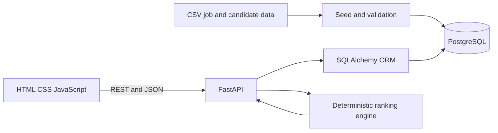
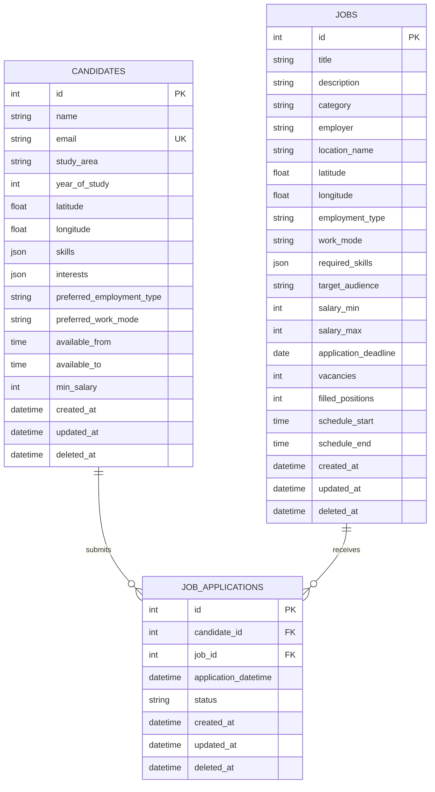

# CareerMatch — Technical Documentation

**Course:** Implementation of Solution 2  
**Application:** Job and Internship Recommendation System  
**Date:** November 2026  
**Source brief:** `job_internship_recommendation_system_brief.md`  
**Document status:** Complete project-specific draft; **official Week07 documentation template was not supplied**.

## 1. Abstract and objective

CareerMatch is a locally runnable university career-center demonstration. It recommends junior jobs and internships to student profiles using transparent deterministic scores rather than machine learning. The target users are students and recent graduates. The dataset is synthetic and is not sourced from a live job board.

## 2. Architecture



`app/main.py` owns REST routes; `app/schemas.py` owns Pydantic input validation; `app/models.py` defines tables; `app/database.py` configures PostgreSQL; `app/recommender.py` is a pure Python scoring module; `scripts/generate_data.py` creates synthetic CSV; `scripts/seed.py` cleans and upserts rows; `frontend/` renders responsive cards.

## 3. Database design

All tables have `created_at`, `updated_at`, `deleted_at` timestamps. `deleted_at` is used for soft-deleting. The optional `job_applications` table is present but does not add unrequested application endpoints.



Skills and interests are JSON arrays, which correctly support multiple elements; comparisons normalize case and trim whitespace. PostgreSQL stores JSON natively through SQLAlchemy. Relationships are represented by foreign keys in the optional application table.

## 4. Data processing and validation

The reproducible generator uses a fixed random seed for stable fictional names, employers and requirements. It generates **160 jobs, 85 candidates**. Examples span Software Development, Data Analytics, Marketing, Business, Design, Finance, HR, Customer Support, Engineering, Project Management, Sales and Research. Eight cities have geographic coordinates. The run date determines future deadlines (10–139 days ahead), so test jobs remain open when reseeded.

The importer reads UTF-8 CSV, splits comma-separated multi-value attributes, trims whitespace, drops blank or duplicate tokens, casts numeric and date/time types, validates via Pydantic, and upserts by stable ID. It rejects negative wages/vacancies, invalid coordinates, impossible schedules, filled positions exceeding capacity, and salaries with a lower maximum than minimum. Re-running seed refreshes demo records and deadlines. Dataset emails use `example.test` to avoid real recipients.

## 5. API design

FastAPI automatically exposes interactive docs at `/docs` and the OpenAPI schema at `/openapi.json`.

1. `GET /jobs` — optional case-insensitive category, type and `remote_only` query filters, combinable by AND; max 500 results.
2. `GET /jobs/{job_id}` — returns 404 for unknown/soft-deleted jobs.
3. `POST /jobs` — creates a validated job, returns 201.
4. `GET /candidates` — lists active candidates.
5. `GET /candidates/{candidate_id}` — returns 404 for missing/soft-deleted candidates.
6. `POST /candidates` — creates a validated candidate, 201; duplicate email gives 409.
7. `GET /recommendations/{candidate_id}` — ranked score, metadata, total eligible count and reasons; max 200 returned.
8. `GET /recommendations?lat=...&lon=...&skills=...` — stateless matching with documented defaults and optional category.

**Example request:** `GET /jobs?category=Software%20Development&employment_type=Internship&remote_only=true`.

**Example recommendation response** (actual score varies by profile and position):

```json
{
  "candidate_id": 1,
  "candidate_name": "Ana Petrova",
  "total_matches": 151,
  "recommendations": [
    {
      "job_id": 1,
      "title": "Software Development Intern",
      "category": "Software Development",
      "employer": "NovaBridge Labs",
      "employment_type": "Internship",
      "work_mode": "Hybrid",
      "location_name": "Skopje",
      "distance_km": 2.4,
      "salary_min": 18000,
      "salary_max": 27000,
      "application_deadline": "2027-01-15",
      "available_positions": 1,
      "score": 87,
      "score_breakdown": {"skills": 23.33, "education": 15, "employment_schedule": 15, "location_mode": 13, "salary": 10, "interest": 10},
      "matched_skills": ["python", "sql"],
      "reason": "Matches python, sql skills; fits your study area; is 2.4 km away; meets your minimum salary."
    }
  ]
}
```

This is a schematic example illustrating field structure, **not a captured API result**. Use Swagger for actual live outputs.

## 6. Recommendation scoring — explicit formula

Only jobs with `deleted_at IS NULL`, `application_deadline >= today` and `vacancies > filled_positions` qualify. All other factors are **soft preferences**, including missing skills and nonmatching education; this avoids hiding potential opportunities when candidate preferences are incomplete.

`score = round(35×skills + 15×education + 15×employment_schedule + 15×location_mode + 10×salary + 10×interest)`. Each component is in `[0,1]`. Total is clamped to `[0,100]`. Breakdown points are returned per component. Scores are sorted descending, ties by job ID ascending (fully deterministic).

### Skills — 35 points

`matching_required_skill_count / total_required_skill_count`. Tokens compare case-insensitively after trimming; empty job requirements score 1.0 (no qualifications to satisfy). Candidate with none of the required skills scores zero skill points, **not automatic rejection**.

### Education — 15 points

1.0 for exactly matching `study_area` and `target_audience` or audience of `All Graduates`, `All Students`, `All Applicants`, or `Any`; otherwise 0.0. This intentionally does not infer degree equivalence from names.

### Employment and schedule — 15 points

`0.6 × employment_type_match + 0.4 × fraction_of_job_work_hours_covered`. Employment type gets 1.0 for exact match, 0.3 otherwise. Fraction is overlap minutes divided by job's scheduled minutes, capped at 1.0. Working hours stored explicitly in each generated job; candidate availability provided as `available_from`/`available_to`.

### Location and work mode — 15 points

Haversine calculates great-circle distance in kilometers for hybrid and on-site jobs: Earth radius = 6371.0088 km, latitude/longitude in radians. Distance fitness is 1.0 up to 10 km, 0.7 up to 30 km, 0.3 up to 80 km, 0 above 80 km. Mode fitness is 1.0 if exactly preferred, 0.7 if either mode is hybrid and there is a mismatch, otherwise 0.35. Final nonremote location score is `0.5 × distance_fit + 0.5 × mode_fit`. For remote positions, distance is `null` and mode fitness is 1.0 for a candidate preferring remote or hybrid, 0.65 for on-site preference. Remote roles therefore incur no geographic penalty.

### Salary — 10 points

All salaries are monthly Macedonian denars (MKD). If the job's `salary_max` meets the candidate's minimum, salary compatibility is 1.0. If below, compatibility is `0.4 × salary_max / max(1, min_salary)`. If salary is missing, compatibility is **neutral 0.5** (5/10 points) and the reason explains that the salary is undisclosed. Optional salary minimum does not control exclusion.

### Interests — 10 points

1.0 when the job category appears within the candidate's normalized list of interests; 0 otherwise.

### Vacancies and deadline

Vacancy availability and deadline are used as eligibility rules, rather than extra score weight. This is defensible because recommending closed positions is misleading. Jobs expiring **today** remain eligible, and only jobs with deadlines *before* today are excluded.

## 7. Frontend implementation

`frontend/index.html`, `styles.css`, `app.js` use HTML, CSS and vanilla JS. The browser queries `/candidates` and `/jobs`, populates candidate/category controls, calls `/recommendations/{id}`, displays score, employer, salary, distance, deadline and score reasons, and filters recommendations in the client by category/type/mode. Required backend filters are independently implemented by `/jobs`. UI includes loading, API-error and no-results states. The URL supports `?candidate_id=1`. Layout adapts to narrow screens using CSS media queries. The visual design does not need a production UI framework.

## 8. Testing and evidence

Run `python -m pytest -q`. The test suite checks seed sizes, every required endpoint, combined job filters, duplicate candidate email handling, invalid jobs, invalid latitude, order and bounds of recommendations, explanation fields, perfect matches, expired listings, full vacancies, deleted jobs, missing salary, missing skills and distance calculations. Tests use isolated in-memory SQLite for speed, with production configured for PostgreSQL; **a live PostgreSQL startup is a separate manual verification step**.

Record the console output from the tests, and use `/docs` to demonstrate the exact backend routes. Take screenshots of the frontend, Swagger API outputs and `docker compose ps` for your project submission. Automated tests cannot verify physical appearance; visually check desktop/mobile in browser as well.

## 9. Constraints and improvements

No accounts or authentication (not required). Dataset is synthetic, not live or licensed listings. The app has no automatic job crawlers, job applications UI, SQL migrations, audit history UI, or external notifications. Such capabilities would be suitable for production but are outside the coursework scope. Production would need authorization, rate limits, pagination, monitoring, DB migrations and data privacy work. Current setup is intentionally optimized for local development and explainable university demonstration.

## 10. Reproducibility

See root `README.md` for Python/Docker requirements, `.env`, seeding, launch and testing instructions. Push to GitHub using `git init`, `git add .`, `git commit -m "Initial CareerMatch implementation"` and a remote you own. Never commit `.env`. Official I am NEXT Week07 template still needs to be applied before final coursework submission.
